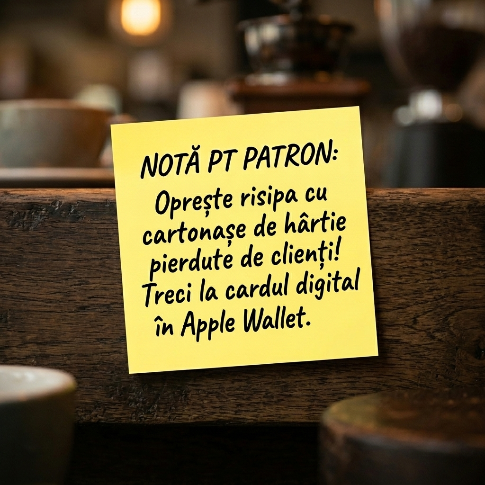
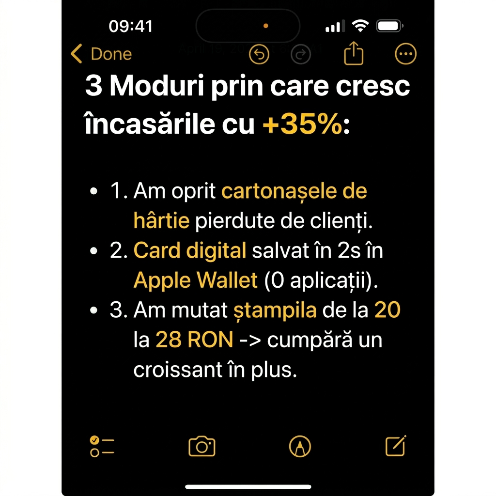
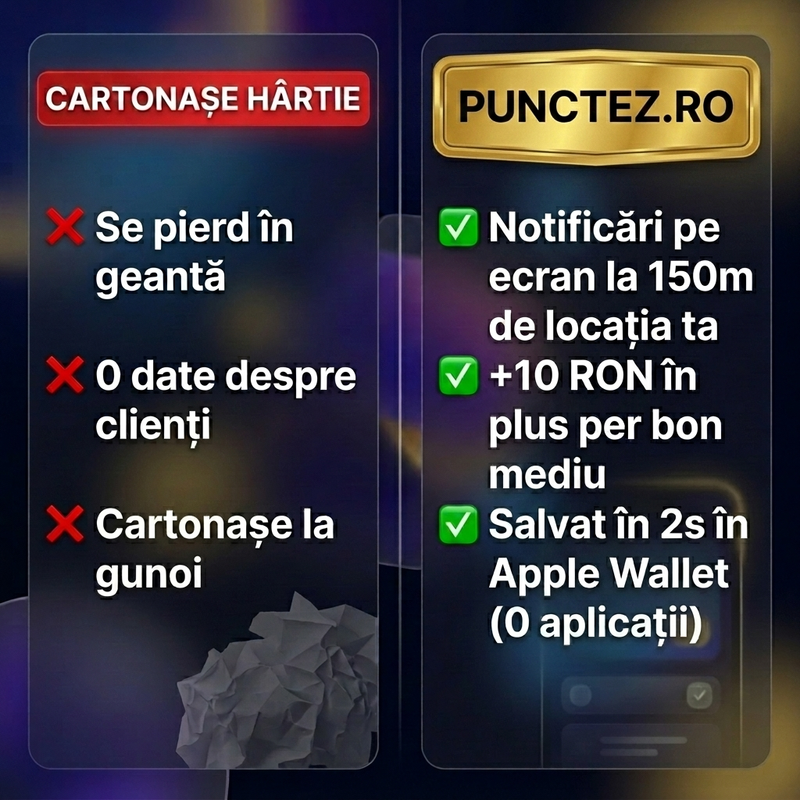

# Ad Creative Lab

**Reverse-engineer short-form ads that already work, then turn the patterns into ready-to-run image and video prompts.**

This is the creative research workflow behind the Meta Ads for [Punctez.ro](https://punctez.ro), a digital loyalty-card SaaS for local businesses.

```
winning reels (.mp4) ──frames──▶ 1 frame/second per reel
                     ──transcribe──▶ Whisper transcript per reel
                                         │
                       human analysis ◀──┘   → REELS_CREATIVES_ANALYSIS.md, 40_AD_FORMATS_FULL_LIST.md
                              │
                  playbook/top10.json  (format · psychology · image prompt · motion prompt)
                              │
                     ──playbook──▶ TOP_10_ADS_PLAYBOOK.md  ──▶ Nano Banana / Midjourney / Sora / Runway
```

## The output

Ads generated from the playbook prompts (`playbook/generated/`):

<p>
  
  
  
</p>

The folder keeps the iterations too (`_v2`, `_v3`, `_patron`, `_color_pop`...), so you can see how each concept was refined.

## The 10 formats

| # | format | why it converts |
|---|---|---|
| 1 | Sticky note | looks personal, not corporate: skips ad blindness |
| 2 | iPhone Notes | reads like the owner's own private note |
| 3 | Us vs. Them | stark contrast removes the thinking effort |
| 4 | News headline | borrows media authority + curiosity gap |
| 5 | Apology / scarcity | loss aversion, FOMO |
| 6 | iMessage chat | people can't resist eavesdropping |
| 7 | Tear-off ticket | tactile urge to grab the coupon |
| 8 | Instagram poll | forces a micro-interaction |
| 9 | AOV growth chart | speaks to the owner's ROI math |
| 10 | "Don't buy this" | reverse psychology pattern interrupt |

Every entry in `playbook/top10.json` has a still-image prompt and a motion prompt. The full write-up is in [`playbook/TOP_10_ADS_PLAYBOOK.md`](playbook/TOP_10_ADS_PLAYBOOK.md); the analysis of the source reels is in [`REELS_CREATIVES_ANALYSIS.md`](REELS_CREATIVES_ANALYSIS.md). Both are in Romanian, the market they were written for.

## Usage

```bash
pip install -r requirements.txt

python reel_lab.py frames     reels/            # FRAMES_<reel>/frame_NN_sec_SS.jpg, 1 per second (--every 0.5 for more)
python reel_lab.py transcribe reels/            # <reel>_TRANSCRIPT.md + reels_summary.json (Whisper base)
python reel_lab.py playbook   playbook/top10.json
```

Edit `top10.json` for your own product and re-render the playbook.

## What is not in the repo

The source reels belong to their creators, so the videos, extracted frames and transcripts are not included (and are git-ignored). Only the analysis, the prompts and the ads generated from them are.

## License

Code: MIT. Analysis, prompts and generated images: © Punctez.ro, shared for reference.
